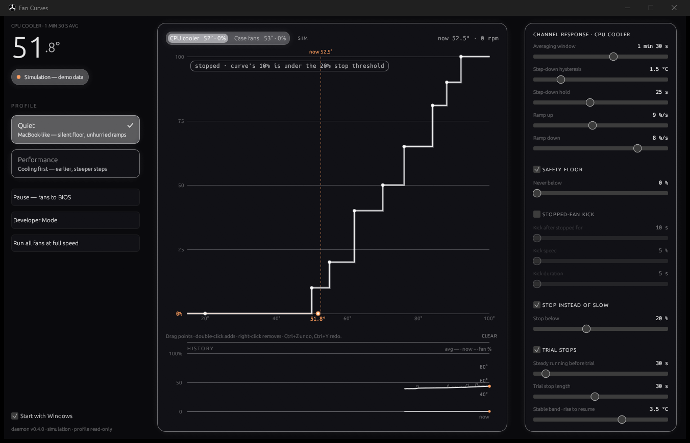

# Fan Curves

MacBook-like fan control for desktops. Fans sit **fully stopped at idle**,
ignore short temperature spikes entirely, and ramp up smoothly only under
*sustained* load — the way Apple laptops manage their fans, applied to your
motherboard's fan headers and NVIDIA GPU fans.



## Why

Motherboard "smart fan" curves react to the *instantaneous* CPU temperature. On a
modern CPU that value jumps 15–20 °C for half a second every time a browser tab
opens, so the fans audibly surge and settle all day — the classic desktop
"whoosh… whoosh…" that a MacBook never does. A MacBook drives its fans from a
slow-moving average and simply doesn't care about spikes.

Fan Curves does the same for a desktop:

- **The curve is driven by a rolling average** (up to 5 minutes; the default
  Quiet preset uses 90 s for the CPU). A brief compile or a game loading screen
  barely moves it; fan speed only follows heat that *stays*.
- **Staircase curves, not slopes.** Each curve point opens a flat band — the fan
  holds one speed across a whole temperature range instead of constantly
  micro-adjusting.
- **Stepping down is deliberate**: the average must fall below the band by a
  hysteresis margin *and stay there* for a hold period before the fan slows.
  No flapping at band edges.
- **Slew-rate limiting** makes every change a gradual, barely audible glide
  instead of a jump.
- **Stopped means stopped**: a 0 % floor at idle, plus *zero snap* — any target
  below a threshold (default 20 %) runs the fan at 0 % instead of a slow crawl.
- **Stop probe**: a fan that has been running steadily with stable temperatures
  gets trial-stopped; if the temperature holds, it stays off. If the trial fails,
  a backoff prevents on/off cycling.
- **Stopped-fan kick** (optional, off by default): periodically spins stopped
  fans for a few seconds.

## How it is built

Three small Rust programs:

- **`fan-daemon`** — the only resident part. Runs elevated and hidden, reads
  the sensors, runs the control loop about once a second and writes the fan
  duties. On pause, exit or a failed write it hands every fan back to the
  BIOS or the GPU driver. About 1 MB on disk.
- **`fan-tray`** — a tray icon at ordinary privilege: live temperatures in the
  tooltip, pause/resume, and a way to open the window.
- **`fan-ui`** — the window. Opens on demand, talks to the daemon over a local
  socket, and exits completely when closed; fan control carries on without it.

## Hardware support

| | |
|---|---|
| Motherboard headers (Windows) | Nuvoton **NCT6686D** Super I/O (the NCT6683D and NCT6687D share the code path but are untested), driven natively through [PawnIO](https://pawnio.eu). Verified on an ASRock X870 Steel Legend WiFi. |
| CPU temperature (Windows) | AMD Tctl and per-CCD temperatures (verified on a 9950X3D). |
| GPU fans (Windows) | NVIDIA cards through the driver's NVML library. Verified on an RTX 5080. A 0 % target hands the fan to the driver's own idle fan-stop. |
| Linux | `hwmon` sysfs backend. It compiles, but has not been run on real hardware yet. |

Other Super I/O chips are not supported. **Pump headers are never assigned
automatically** — you can assign one by hand, at your own risk.

## Install (Windows)

Requirements: Windows 10/11, [PawnIO](https://pawnio.eu) installed, the
[Rust toolchain](https://rustup.rs), and an elevated PowerShell for the first
install.

```powershell
git clone https://github.com/qqubica/fan-curves
cd fan-curves
powershell -NoProfile -ExecutionPolicy Bypass -File .\windows\install.ps1
```

The script builds the three programs, copies them to
`%LOCALAPPDATA%\Programs\FanCurvesRust`, registers two logon tasks (the daemon,
elevated and hidden; the tray icon) and starts them. Run the same script again
to update; an update needs no elevation.

Only the tray icon appears at logon. Double-click it to open the window. On
first start the daemon detects sensors and fans and applies the
**Quiet (MacBook-like)** preset; every later edit is saved to
`%AppData%\FanCurves\profile.json`.

To uninstall: untick **Start with Windows** in the window (or run
`fan-daemon.exe --uninstall-autostart` elevated), choose *Close tray*, stop the
daemon with `fan-daemon.exe --send shutdown`, and delete the install folder.

## Using it

- **Presets**: `Quiet` (the default) or `Performance`. A preset overwrites the
  curves and tuning but keeps your sensor and fan assignments; Ctrl+Z takes
  the switch back.
- **Curve**: drag points, double-click to add, right-click to remove,
  Ctrl+Z / Ctrl+Y to undo and redo.
- **Developer panel**: per-channel averaging window, hysteresis, hold and ramp
  rates; safety floor, stop threshold, trial stops; which sensors and fans
  each channel uses, with live readings.
- **History strip**: ten minutes of average temperature, raw temperature and
  commanded fan speed, with a marker for every fan stop and start. Scroll or
  drag to look back over the last ~24 hours.
- **Why-chip**: whenever the fan speed differs from what the curve says, a
  chip on the chart explains why (ramping, waiting out a step-down, stopped
  below the threshold, trial stop…).
- **Pause** hands every fan back to the BIOS. **Run all fans at full speed**
  is a temporary override for testing airflow or noise.

Logs for reviewing behaviour are in `%AppData%\FanCurves\logs`: a CSV row per
channel per tick, and `behavior.txt` with only the changes.

## Build and test

```
cargo test --workspace
cargo run --release -p fan-ui -- --sim    # the full UI on simulated hardware
```

`--sim` fakes a modern CPU with idle spikes and load phases, so the whole UI
and control loop can be tried without touching real fans. Nothing a simulation
does is saved.

Layout: `crates/fan-core` is the engine (curves, response filter, tick,
simulation, Linux backend), `crates/fan-daemon` the daemon and Windows
backends, `crates/fan-tray` and `crates/fan-ui` the tray and window,
`windows/` the install scripts.

The first versions of this project (v0.1.0–v0.3.1) were a .NET/WPF app; that
code is in the git history at tag `v0.3.1`.

## License

MIT. The daemon embeds the signed PawnIO modules `LpcIO` and `AMDFamily17`
from [PawnIO.Modules](https://github.com/namazso/PawnIO.Modules) (LGPL-2.1).
